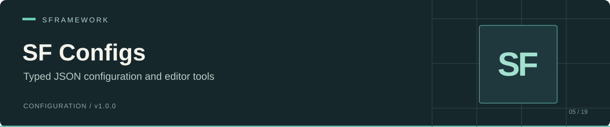

# SF Configs

JSON configuration types, a Resources loader, and Inspector selectors for SFramework projects. Define global settings or a tree of nodes in C#, store their values in JSON, and query loaded configurations by their concrete type.

Package: `sp.sframework.configs` · Version: `1.0.0` · [MIT license](LICENSE.md)

[Install](#install) · [Load a configuration](#load-a-configuration) · [Node trees](#node-trees) · [Editor workflow](#editor-workflow) · [API](#api) · [Limits](#limits-and-troubleshooting)

## Install

In Unity's Package Manager, choose **Add package from git URL** and enter:

```text
https://github.com/huran438/sf-configs.git#main
```

The package manifest does not declare dependencies. Install the requirements before using the package:

| Requirement | Reference in this package |
| --- | --- |
| [SF Core](https://github.com/huran438/sf-core) | `SFramework.Core.Runtime` and, for editor tools, `SFramework.Core.Editor` |
| UniTask | `UniTask` runtime assembly |
| Newtonsoft.Json | `Newtonsoft.Json.dll` in both assembly definitions |

Use the namespaces `SFramework.Configs.Runtime` and `SFramework.Configs.Editor`. If your scripts use assembly definitions, reference `SFramework.Configs.Runtime`; editor scripts also need `SFramework.Configs.Editor`.

The manifest specifies no Unity version. This README reflects static source inspection; no Unity Editor, player, or platform validation accompanies it.

## Load a configuration

Create `GameGlobalConfig.cs` in your runtime scripts:

```csharp
using System;
using SFramework.Configs.Runtime;

[Serializable]
public sealed class GameGlobalConfig : SFGlobalConfig
{
    public int StartingCoins = 50;
}
```

Create `Assets/Resources/Configs/GameGlobalConfig.json`:

```json
{
  "Type": "GameGlobalConfig",
  "Version": 0,
  "StartingCoins": 50
}
```

Keep `Type` as the first or last JSON property. The runtime loader removes whitespace and checks those two positions before deserializing. Use the exact C# class name, including its case, without a namespace.

The following component loads configurations without a project-specific bootstrap. Save it as `ConfigsExample.cs` and attach it to a GameObject:

```csharp
using System.Threading;
using SFramework.Configs.Runtime;
using UnityEngine;

public sealed class ConfigsExample : MonoBehaviour
{
    private readonly SFConfigsService _configs = new SFConfigsService();

    private async void Start()
    {
        await _configs.Init(CancellationToken.None);

        if (_configs.TryGetGlobalConfig<GameGlobalConfig>(out var config))
            Debug.Log($"Starting coins: {config.StartingCoins}");
        else
            Debug.LogError("GameGlobalConfig JSON was not loaded.");
    }

    private void OnDestroy()
    {
        _configs.Dispose();
    }
}
```

For an SFramework bootstrap, register `ISFConfigsService` to `SFConfigsService` in your `SFContextRoot.Bind()` implementation. `SFContextRoot` injects registered services and then awaits their `Init` methods in registration order. Query configurations after that initialization completes.

```csharp
SFContainer.Register<ISFConfigsService, SFConfigsService>();
```

The registration statement requires `using SFramework.Core.Runtime;`. Keep one initialization path for each service instance.

## Node trees

Use `SFNodesConfig` for a root and `SFConfigNode` for its descendants. Expose descendants through `Children` and serialize your own storage field. Mark the derived `Children` getter with `[JsonIgnore]` to avoid writing a second copy of the same collection.

```csharp
using System;
using Newtonsoft.Json;
using SFramework.Configs.Runtime;

[Serializable]
public sealed class EnemyCatalog : SFNodesConfig
{
    public EnemyNode[] Enemies = Array.Empty<EnemyNode>();

    [JsonIgnore]
    public override ISFConfigNode[] Children => Enemies;
}

[Serializable]
public sealed class EnemyNode : SFConfigNode
{
    public int Health = 100;

    [JsonIgnore]
    public override ISFConfigNode[] Children => null;
}
```

Store this JSON under a `Resources` folder:

```json
{
  "Type": "EnemyCatalog",
  "Version": 0,
  "Id": "enemies",
  "Enemies": [{ "Id": "scout", "Health": 75 }]
}
```

During `Init`, the service calls `BuildTree()` on each `ISFNodesConfig`. The example root receives `FullId == "enemies"`; its scout node receives `FullId == "enemies/scout"` and a `Parent` reference to the root. Call `BuildTree()` yourself after constructing or changing a tree in memory.

`SFConfigsExtensions.GetSFId("enemies", "scout")` joins segments into `enemies/scout`. The package does not provide a runtime lookup method that resolves this string to a node; traverse your typed collection or build an index in your application.

## Editor workflow

Configure the editor search paths in `Assets/SFramework/Settings/SFConfigsSettings.json`:

```json
{
  "ConfigsPaths": ["Assets/Resources/Configs"]
}
```

`SFConfigsSettings` inherits the editor-only settings loader from SF Core. The first lookup creates a default settings file when none exists and returns `false`. Fill in `ConfigsPaths`, then choose **Tools > SFramework > Refresh Configs**.

Refresh scans `TextAsset` files under those paths, matches their `Type` values to concrete `ISFConfig` classes, and builds the editor cache. For a class with no matching file, refresh attempts to instantiate a default configuration and write `<ClassName>.json` into the first usable configured folder. Concrete configuration classes need a parameterless constructor for this step. The editor also refreshes after its initial update following assembly loading.

Use paths under `Assets`; include a `Resources` folder when the runtime loader must read the same files. `ConfigsPaths` controls editor discovery only. Runtime initialization loads **all** `TextAsset` resources with `Resources.LoadAll<TextAsset>(string.Empty)`.

For Inspector fields:

```csharp
using SFramework.Configs.Runtime;
using UnityEngine;

public sealed class EnemySelection : MonoBehaviour
{
    [SFId(typeof(EnemyCatalog))]
    public string EnemyId = string.Empty;

    [SFAsset(typeof(GameObject))]
    public string PrefabKey = string.Empty;
}
```

`SFId` uses the **configuration root type**, not the descendant node type. Its optional `indent` argument selects a slash-separated depth: `0` for root IDs, `1` for direct children, and `-1` for the deepest cached depth. The drawer stores a string; its empty selection clears that string.

`SFAsset` provides an editor object selector on a string field. For general assets it prefers a Resources-relative path, then an Addressables address, then an `Assets/...` path. For sprites it may store `key[SpriteName]`; atlas handling also has editor asset-path fallbacks. Addressables detection uses reflection, so the selector does not require an Addressables assembly reference. Supply your own runtime asset loader and verify that it supports the stored key format. An `Assets/...` fallback can display in the editor without being a loadable player key.

For a configuration editing window, add [SF Configs Odin](https://github.com/huran438/sf-configs-odin) and its external Odin requirements.

## API

| API | Behavior |
| --- | --- |
| `ISFConfig` | `Type` string and `Version` long metadata |
| `SFGlobalConfig` / `ISFGlobalConfig` | Base class and marker for a global configuration |
| `SFNodesConfig` / `ISFNodesConfig` | Root configuration with `Id`, `FullId`, `Parent`, `Children`, and `BuildTree()` |
| `SFConfigNode` / `ISFConfigNode` | Node base class and tree contract |
| `SFConfigsService.Init(CancellationToken)` | Loads Resources JSON and builds node trees; returns a completed UniTask after synchronous work |
| `TryGetConfigs<T>(out T[])` | Queries the exact registered concrete type; returns an empty array on a miss |
| `TryGetGlobalConfig<T>(out T)` | Returns one loaded instance, or creates a default `T` and returns `false` |
| `TryGetNodesConfigs<T>(out T[])` | Concrete `SFConfigsService` helper; absent from `ISFConfigsService` |
| `Configs` | Enumerates the configurations the instance has loaded |
| `SFNodeModel<T>` | Injects the model in its constructor, then assigns its read-only `Node`; subclasses implement `Dispose()` |
| `SFConfigsEditorUtility.RefreshConfigs()` | Rebuilds editor caches and attempts to create missing configurations |
| `GetNodePaths(string, int)` | Reads cached selector paths by simple type name and depth |
| `FindConfigsWithPaths(Type)` | Reads cached configuration instances with their source asset paths |
| `FormatConfigs(bool)` | Rewrites configured TextAssets as JSON with a new Unix timestamp in `Version` |
| `ToUnixTime(DateTime)` / `FromUnixTime(long)` | Converts between UTC dates and Unix seconds |

## Limits and troubleshooting

- A missing runtime configuration usually means its JSON sits outside Resources, its `Type` differs from the class name, or `Type` appears in the middle of the object. Editor refresh accepts `Type` in more positions than the runtime loader.
- Type keys use simple names. Avoid configuration classes with the same name in different namespaces. Queries use exact types rather than interfaces or base types.
- Keep one global configuration file per concrete type. The service stores instances in a `HashSet` and returns the first available global instance without a defined ordering.
- Treat service instances as single-use. Repeated `Init` calls add instances; `Dispose` clears the type lookup dictionary but leaves the `Configs` collection intact. The initialization method does not check its cancellation token.
- The obsolete `GetConfigs<T>()` casts the entire configuration collection. It can throw when the collection contains other types; use `TryGetConfigs<T>()`.
- Keep node trees acyclic and child entries non-null. Tree construction does not validate duplicate IDs or cycles. A root-only configuration should return `null` from `Children`; an empty root array produces no root ID in the editor cache. Selector order comes from hash sets, and the deepest-depth default can omit shorter branches.
- `Version` supports timestamps in editor tools. The package has no migration, schema validation, remote download, or runtime save implementation. `FormatConfigs` parses every TextAsset under its configured paths as JSON, so keep unrelated text files outside those paths.
- Injection runs before `SFNodeModel<T>.Node` receives its value. An injected initialization method on a model must not depend on `Node` at that point.

## Source and related packages

- [Runtime loader](Runtime/SFConfigsService.cs), [configuration contracts](Runtime/ISFConfig.cs), and [tree root](Runtime/SFNodesConfig.cs)
- [Editor discovery and formatting](Editor/SFConfigsEditorUtility.cs), [ID selector](Editor/SFIdAttributeDrawer.cs), and [asset selector](Editor/SFAssetAttributeDrawer.cs)
- [SF Core](https://github.com/huran438/sf-core), [SF Configs Odin](https://github.com/huran438/sf-configs-odin), and [SF NodeCanvas](https://github.com/huran438/sf-nodecanvas)

Source snapshot: [`c83286ae8c215d928d5056e106c248a3536b09f0`](https://github.com/huran438/sf-configs/commit/c83286ae8c215d928d5056e106c248a3536b09f0) (`main`). Example validation: static API review only; no compilation or execution in Unity.
